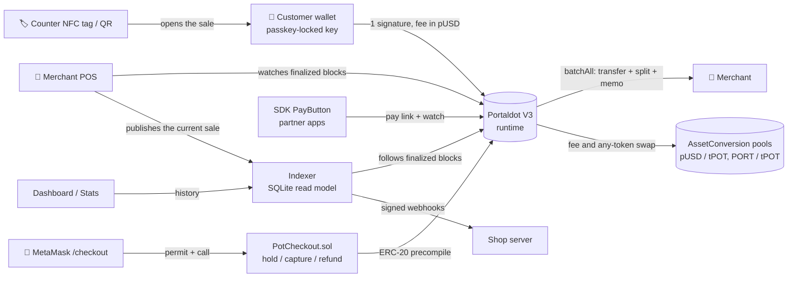

<div align="center">
  
  <h1>StableTap</h1>
  <p><strong>Pay in dollars on Portaldot, and pay the fee in dollars too.</strong><br/>
  Customers tap or scan, approve with their fingerprint, and never spend the network token.</p>

  [](https://stabletap.vercel.app)
  [](https://stabletap.vercel.app/stats)

  
  
  [](LICENSE)
</div>

> **Portaldot Hacker House 2026 · Ecosystem DApps.** Live on the Portaldot V3 testnet with a test
> stablecoin (pUSD). Every flow below ran on the real testnet.

---

## 💡 The problem

- People hold dollars, not gas tokens. On most chains, paying with a stablecoin still needs a
  second coin for the fee, so a new user's first payment fails.
- Stripe (Tempo), Circle (Arc) and Polkadot Hub each built "fee in stablecoin" to fix this.
- **Portaldot V3 already ships the same runtime pieces** (assets, a built-in DEX and asset-based
  fee payment), but no product uses them yet.

## ✨ What it does

| | |
|---|---|
| 🔑 **Wallet with a passkey** | The key is created on the phone and locked by fingerprint or face. No extension, no seed phrase to type. |
| 📲 **Tap or scan to pay** | The shop's POS shows a QR, or the customer taps an NFC sticker at the counter. One signature pays the invoice. |
| 💵 **Fee in dollars** | The fee is taken from the customer's pUSD through Portaldot's pool. The account's tPOT is never spent. |
| 🔄 **Pay with any token** | A customer holding only PORT (a community token) pays a dollar invoice; the pool swaps it in the same transaction. The shop still gets exact dollars. |
| 🏪 **Merchant dashboard** | Invoices matched on chain by memo, 99/1 split with the platform, refunds, signed webhooks, payout to a 2-of-3 team multisig. |
| 🛡 **Replay and expiry** | An invoice can be paid once and expires after 5 minutes of chain time. |
| 🦊 **MetaMask path** | A Solidity contract (`PotCheckout`) holds dollars and captures part of them, through Portaldot's ERC-20 precompile. |
| 🧩 **Pay button for other apps** | `@stabletap/sdk` gives any Portaldot app a `<PayButton/>` using the same open pay-link format. |

---

## 🧭 How it works



Every customer action is **one signed native extrinsic** with the fee paid in pUSD
(`ChargeAssetTxPayment` with `assetId = pUSD`):

| Action | Calls inside `utility.batchAll` |
|---|---|
| Pay | `assets.transferKeepAlive` + `system.remarkWithEvent("stabletap:<invoice>")` |
| Split 99/1 | two transfers + memo |
| Pay with any token | `assetConversion.swapTokensForExactTokens` + transfers + memo |
| Refund | reverse transfer + `stabletap:refund:<invoice>` memo |

The invoice lives in the QR or pay link, and payment state is read from finalized blocks, so the
core flow needs no backend. The indexer only adds history, stats, webhooks and tap terminals.

---

## 🟣 Why Portaldot

- **Fee payment in any asset is built into the runtime.** `AssetConversionTxPayment` swaps the fee
  from pUSD to tPOT through the native pool, so a wallet holding only the one-time deposit can pay.
  The same payment with a tPOT fee is rejected by the node (`1010 Inability to pay some fees`).
- **A native DEX** (`AssetConversion`) lets a customer pay with another token and still deliver
  exact dollars, in one transaction.
- **Native multisig and memos** give team payouts and on-chain invoice matching without contracts.
- **EVM compatibility** (pallet-revive) and the Assets **ERC-20 precompile** let the same pUSD be
  used from MetaMask and Solidity.

---

## 🔗 Portaldot testnet deployment

Network: Portaldot V3 testnet (`wss://test-node-v3.portaldot.dev`, spec 3002).
Explorer: <https://scanner-testnet-v3.portaldot.dev>.

| Item | Value |
|---|---|
| pUSD (test stablecoin) | asset id `7777`, 6 decimals, pool 150 tPOT : 150 pUSD |
| PORT (test community token) | asset id `7780`, 6 decimals, pool 100 tPOT : 200 PORT |
| pUSD ERC-20 precompile | `0x00001E6100000000000000000000000000010000` |
| `PotCheckout.sol` (EVM, chain id `420420777`) | `0x7510b0A07fE47B293c2F4f097AC1FBFC5CfA7e48`, deployed in block 156790 (tx `0xe2cc14b8…1b40`) |

### Proof on chain

All successful, all with the fee paid in pUSD (or PORT) and **0 tPOT spent** by the customer.

| What happened | Transaction |
|---|---|
| pUSD created with its fee pool, one transaction | [148225-1](https://scanner-testnet-v3.portaldot.dev/#/extrinsics/148225-1) · `0x50ac4337…059f` |
| First payment, $4.50, fee $0.018 in pUSD | [148241-1](https://scanner-testnet-v3.portaldot.dev/#/extrinsics/148241-1) · `0x144a9a16…1813` |
| Split payment: shop $4.455, platform $0.045 | [149659-1](https://scanner-testnet-v3.portaldot.dev/#/extrinsics/149659-1) · `0xfc62323a…6b36` |
| Refund by the merchant, fee in pUSD | [149662-1](https://scanner-testnet-v3.portaldot.dev/#/extrinsics/149662-1) · `0x2718f93f…a1e1` |
| Paid with PORT, shop got exact pUSD | [149665-1](https://scanner-testnet-v3.portaldot.dev/#/extrinsics/149665-1) · `0x559d7764…c394` |
| Takings sent to a 2-of-3 multisig | [149671-1](https://scanner-testnet-v3.portaldot.dev/#/extrinsics/149671-1) · `0xb4ac74d0…829a` |

**MetaMask path (EVM RPC, gas in tPOT).** The same pUSD, through its ERC-20 precompile and `PotCheckout`:

| What happened | Block · EVM tx |
|---|---|
| Contract deployed | 156790 · `0xe2cc14b8…1b40` |
| Paid $4.50 with one permit signature; same invoice again rejected | 156799 · `0xe5b4285d…71d7` |
| Held $50 deposit | 156801 · `0xeb505504…090b` |
| Captured $42, $8 returned to the customer in the same tx | 156803 · `0xf382a8bd…0bc9` |
| Shop refunded $2 | 156805 · `0xf8be005f…099e` |

Full records are in [`evidence/`](evidence). The explorer lags the chain, so very new transactions
can take a while to appear there. The [stats page](https://stabletap.vercel.app/stats) reads the
same data from our indexer.

---

## ✅ What was tested

- **Live testnet, by script with hard checks:** setup, payment, split, refund, pay with PORT and
  the multisig payout above (`pnpm --filter @stabletap/engine live:flows`).
- **Hosted app on the live testnet, in Chrome:** new wallets funded by the faucet, POS charges
  $1.00, the customer sees "with a tPOT fee: would fail", pays, receipt shows fee in dollars and
  tPOT spent 0.00, POS turns Paid (block #156435).
- **Hosted MetaMask checkout on the live testnet, in Chrome** (EIP-6963 test wallet): hold $3,
  replay rejected, shop captures $2 ($1 back), refunds $1, balances exact, no console errors.
- **On a local fork of the testnet (Chopsticks):** every flow in the browser, including tap to
  pay, the pool gauge, webhooks, refunds, the team wallet, the partner Pay button, and the
  contract against the real runtime and precompile (deploy, pay, replay rejected, hold $50,
  capture $42, refund).
- **Tests:** engine 7 unit + 6 fork, indexer 6, web 1, SDK 2, contracts 6.

**Limits:** testnet only, pUSD is a test token we issue, not audited. Each account needs the
0.1 tPOT existential deposit once ("never spends tPOT", not "holds zero"). MetaMask transactions
pay gas in tPOT: on this testnet a pay or hold costs ≈ 3.9 tPOT (gas plus storage deposit), capture
and refund ≈ 0.02 tPOT. "Tap" is a fixed NFC sticker at the counter, not phone-to-phone NFC. The hosted app has no
platform address set, so its sales are not split (the 99/1 split is proven by the script above).
The SDK is not published to npm yet.

---

## 🚀 Try it

Use Chrome on Android, Safari 18+ on iPhone, or desktop Chrome.

1. Open <https://stabletap.vercel.app/wallet> and tap **Create wallet**.
2. Tap **Get 20 test dollars**.
3. On a second device or browser, open <https://stabletap.vercel.app/pos>, set a shop name, use a
   wallet address as payout, and charge an amount.
4. Scan the QR with the wallet and pay with your fingerprint. Both sides show the transaction.
5. See it on the [stats page](https://stabletap.vercel.app/stats).

---

## 🛠 Tech stack

| Layer | Built with |
|---|---|
| Chain | Portaldot V3: Assets, AssetConversion, AssetConversionTxPayment, Utility, Multisig, Revive |
| Engine | TypeScript, polkadot.js 17 with types generated from the live runtime |
| Web app | Next.js 16, React 19, WebAuthn PRF passkeys, AES-GCM key vault, ZXing QR, Web NFC |
| Indexer | Node.js 24, built-in `node:sqlite`, Standard Webhooks |
| Contract | Solidity 0.8.28, Hardhat 3, viem, OpenZeppelin (tests) |
| SDK | tsdown (ESM), React `<PayButton/>` |
| Hosting | Vercel (web), Google Compute Engine + Caddy (indexer) |

## 📁 Repository

```text
packages/engine   Payment engine: invoices, pay, split, refund, swap, payout, block decoder
packages/sdk      @stabletap/sdk and the React PayButton
apps/web          Wallet, POS, dashboard, stats, tap page, MetaMask checkout, partner demo
apps/indexer      Finalized-block indexer, API, webhooks, tap terminals
contracts         PotCheckout.sol and Hardhat tests
spike             Fee-in-pUSD feasibility check on a Chopsticks fork
evidence          Public testnet records (no secrets)
deploy            Indexer VM setup
docs              Full reference
```

## 🏃 Run it locally

Requirements: Node.js 24 and pnpm 10.

```bash
pnpm install
pnpm spike:fork                              # local fork of the V3 testnet (keep running)
pnpm --filter @stabletap/engine setup:fork   # create pUSD and its pool on the fork
pnpm --filter @stabletap/indexer start:fork  # optional: history, stats, webhooks, tap
pnpm --filter @stabletap/web dev:fork        # http://localhost:3000
```

Tests, testnet setup, every environment variable, the indexer API and deployment steps are in the
[full reference](docs/REFERENCE.md) and [deploy/indexer](deploy/indexer/README.md).

---

## 🤖 AI tool disclosure

AI coding tools were used: Kiro (an AI IDE) for code generation, refactoring, tests, debugging,
documentation and research. AI-written code was reviewed and run against tests and the live
testnet before it was kept.

## 📚 Attribution

All application code was written during the Hacker House (first commit 20 Oct 2026). Built on
open-source libraries under their own licenses: polkadot.js, Chopsticks, Next.js, React, viem,
Hardhat, OpenZeppelin Contracts, tsdown, `barcode-detector` / ZXing, `qrcode`. Webhook signing
follows the Standard Webhooks specification.

Our code is [MIT licensed](LICENSE).
