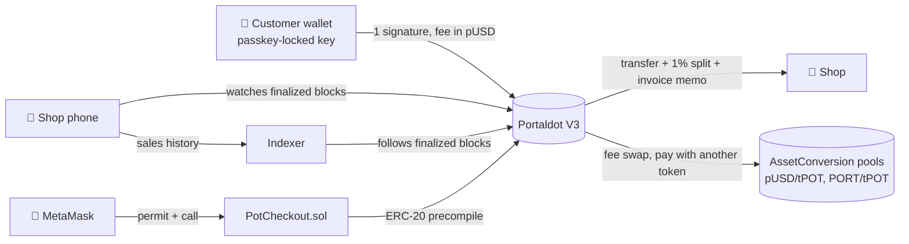

<div align="center">
  
  <h1>StableTap</h1>
  <p><strong>Pay a shop in dollars on Portaldot, and pay the fee in dollars too.</strong><br/>
  Customers scan the shop's QR, confirm with their phone's screen lock, and never spend the network token.</p>

  [](https://stabletap.vercel.app)
  [](https://stabletap.vercel.app/stats)

  
  
  [](LICENSE)
</div>

> **Portaldot Hacker House 2026 · Ecosystem DApps.** Live on the Portaldot V3 testnet with a test
> stablecoin (pUSD). Every flow below ran on the real testnet.

## 💡 The problem

On most chains, paying with a stablecoin also needs the network's own coin for the fee, so a new
user holding only dollars can't pay. Stripe (Tempo) and Circle (Arc) built new chains to fix this.
Portaldot V3 already has the pieces built in: assets, a native swap pool and fee payment in assets.

## ✨ What it does

| | |
|---|---|
| 🔑 **Passkey wallet** | The key is rebuilt from a passkey (WebAuthn PRF), confirmed with the phone's screen lock. Clear the browser or get a new phone: sign in with the same passkey. No extension, no seed phrase to type. |
| 📲 **Scan to pay** | The shop phone shows a QR, the customer scans it. One signature pays. |
| 💵 **Fee in dollars** | The fee is taken in pUSD through Portaldot's pool. The customer never spends tPOT. |
| 🔄 **Pay with another token** | A customer holding only PORT pays a dollar invoice; the pool swaps it in the same transaction and the shop gets exact dollars. |
| 🏪 **Shop app** | Keypad, sales by day, refunds, and a 1% StableTap fee taken in the same transaction. |
| 🔗 **Payment links** | A short link (`/l/<id>`) for an item and price, for selling in WhatsApp or Instagram chats. The chat shows a preview card with the shop, item and price. Each customer gets a fresh invoice. |
| 🦊 **MetaMask checkout** | A Solidity contract (`PotCheckout`) holds and captures the same pUSD through Portaldot's ERC-20 precompile. |

Every payment and sale links to its block on the Portaldot explorer.

## 🧭 How it works



Each payment is one native transaction: `utility.batchAll` with `assets.transferKeepAlive` (shop
and 1% split) and `system.remarkWithEvent("stabletap:<invoice>")`, signed with the fee asset set to
pUSD. The invoice lives in the QR or link and payment state is read from finalized blocks, so the
core flow needs no backend. The indexer adds history and stats.

## 🟣 Why Portaldot

- **Fee in another asset is built into the runtime** (`AssetConversionTxPayment`). A wallet holding
  only pUSD can pay; the same payment with a tPOT fee is rejected (`1010 Inability to pay some fees`).
- **Native swap pool** (`AssetConversion`): pay with another token, the shop still gets exact dollars.
- **EVM compatibility** and the Assets **ERC-20 precompile**: the same pUSD works in MetaMask and Solidity.

## 🔗 Portaldot testnet deployment

Network: Portaldot V3 testnet (`wss://test-node-v3.portaldot.dev`). Explorer:
<https://scanner-testnet-v3.portaldot.dev>.

| Item | Value |
|---|---|
| pUSD (test stablecoin) | asset id `7777`, 6 decimals |
| PORT (test token) | asset id `7780`, 6 decimals |
| pUSD ERC-20 precompile | `0x00001E6100000000000000000000000000010000` |
| `PotCheckout.sol` (EVM, chain id `420420777`) | `0x7510b0A07fE47B293c2F4f097AC1FBFC5CfA7e48` (block 156790, tx `0xe2cc14b8…1b40`) |

**Proof on chain.** The explorer lists no extrinsic for transactions whose fee is paid in an asset,
so the links open the block's events, where `AssetTxFeePaid` shows the fee asset (7777 = pUSD).

| What happened | Block · tx |
|---|---|
| pUSD and its fee pool created | [148225](https://scanner-testnet-v3.portaldot.dev/#/extrinsics/148225-1) · `0x50ac4337…059f` |
| First payment, $4.50, fee in pUSD | [148241](https://scanner-testnet-v3.portaldot.dev/#/blocks/148241?tab=events) · `0x144a9a16…1813` |
| Payment with 1% split | [149659](https://scanner-testnet-v3.portaldot.dev/#/blocks/149659?tab=events) · `0xfc62323a…6b36` |
| Refund by the shop | [149662](https://scanner-testnet-v3.portaldot.dev/#/blocks/149662?tab=events) · `0x2718f93f…a1e1` |
| Paid with PORT, shop got exact pUSD | [149665](https://scanner-testnet-v3.portaldot.dev/#/blocks/149665?tab=events) · `0x559d7764…c394` |
| Demo payment from the hosted app, $4.50 | [171797](https://scanner-testnet-v3.portaldot.dev/#/events/171797-13) (`AssetTxFeePaid`) |

MetaMask path (EVM, gas in tPOT): paid $4.50 with one permit (156799, `0xe5b4285d…71d7`), held $50
(156801, `0xeb505504…090b`), captured $42 with $8 returned (156803, `0xf382a8bd…0bc9`), refunded $2
(156805, `0xf8be005f…099e`). Full records are in [`evidence/`](evidence).

## ✅ Testing

- Live testnet flows by script with hard checks (`pnpm --filter @stabletap/engine live:flows`).
- The hosted app on two phones: counter sale, refund, payment-link sale, history and explorer links.
- Unit and fork tests: engine, indexer, web, SDK and contracts.

**Limits:** testnet only; pUSD is a test token we issue; not audited. Each new account gets a 0.1 tPOT
deposit once, which is never spent. MetaMask transactions pay gas in tPOT.

## 🚀 Try it

Use Chrome on Android, Safari 18+ on iPhone, or desktop Chrome.

1. Open <https://stabletap.vercel.app/wallet>, tap **Create my wallet**, then **Get 20 free test dollars**.
2. On a second device, open <https://stabletap.vercel.app/business>, tap **Set up my shop**, name it and
   tap **Create my shop**.
3. Charge an amount, scan the QR with the wallet and confirm with your phone's screen lock.
4. Open the payment and tap **View on Portaldot explorer**.

## 🗺 Next

- **WooCommerce plugin:** online stores add "Pay with StableTap" at checkout. WooCommerce accepts
  third-party payment plugins; Shopify payment apps are invite-only.
- **Mainnet**, with a real dollar stablecoin.

## 📁 Repository

```text
packages/engine   Payment engine: invoices, pay, split, refund, swap, block decoder
packages/sdk      @stabletap/sdk and a React PayButton (not on npm yet)
apps/web          Wallet, shop (/shop, /sales, /links), link checkout, stats, MetaMask checkout
apps/indexer      Finalized-block indexer and API
contracts         PotCheckout.sol and Hardhat tests
evidence          Public testnet records
docs              Full reference
```

## 🏃 Run it locally

Requirements: Node.js 24 and pnpm 10.

```bash
pnpm install
pnpm spike:fork                              # local fork of the V3 testnet (keep running)
pnpm --filter @stabletap/engine setup:fork   # create pUSD and its pool on the fork
pnpm --filter @stabletap/indexer start:fork  # optional: history and stats
pnpm --filter @stabletap/web dev:fork        # http://localhost:3000
```

Environment variables, tests, the indexer API and deployment steps: [docs/REFERENCE.md](docs/REFERENCE.md)
and [deploy/indexer](deploy/indexer/README.md).

## 📚 Attribution

All code was written during the Hacker House (first commit 20 Oct 2026). Built with Next.js 16, React 19,
polkadot.js, Chopsticks, viem, Hardhat, OpenZeppelin Contracts, tsdown, ZXing and `qrcode`, each under
its own license. Our code is [MIT licensed](LICENSE).
